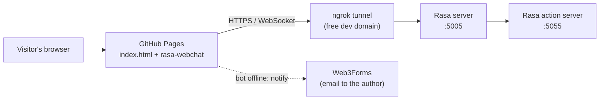

=======
# Smart Tachograph Driver Card Chatbot

A Greek-language virtual assistant, built with **Rasa**, that answers questions about the public service **"First Issuance of a Smart Tachograph Driver Card"** in Greece. The service is also modelled as a **Neo4j knowledge graph** using the Core Public Service Vocabulary (CPSV). Citizens can chat through a web interface, pick topics from quick-reply buttons, and get a personalised document checklist depending on how they plan to apply.

**Live demo:** https://chrisgiamakidis.github.io/Chatbot/

> The Rasa server behind the demo runs on the author's own machine. If it is switched off, the page shows an "offline" card where you can send the author an email notification, and the chat connects automatically once the bot is back (see [Offline notification](#offline-notification)).

> **Disclaimer:** this is an unofficial, informational project. For binding information, always consult the official [gov.gr service page](https://www.gov.gr/ipiresies/epikheirematike-drasterioteta/adeiodoteseis-kai-summorphose/karta-psephiakou-takhographou-odegou).

---

## Table of contents

- [Features](#features)
- [Architecture](#architecture)
- [Tech stack](#tech-stack)
- [Project structure](#project-structure)
- [Offline notification](#offline-notification)
- [Neo4j knowledge graph](#neo4j-knowledge-graph)
- [Author](#author)

---

## Features

- **Greek-language understanding**: intent classification and entity extraction with Rasa NLU, using a multilingual transformer featurizer together with sparse (word and character n-gram) features.
- **Quick-reply topic menu**: a dynamic greeting menu offers the main topics and hides the button for the topic you just asked about.
- **Guided document checklist**: a Rasa form asks whether you will apply **online** or **in person** and returns the matching list of required documents, with input validation on the answer.
- **Help links**: a dedicated action points users to the official gov.gr page, the regional Transport and Communications directorate, and the local Citizen Service Centres (ΚΕΠ).
- **Fallback handling**: low-confidence and ambiguous messages are caught by a fallback classifier instead of getting a wrong answer.
- **Web chat interface**: the [rasa-webchat](https://github.com/botfront/rasa-webchat) widget with Greek labels, a full-screen mode, and a road-themed background.
- **Offline notification**: if the bot is unreachable, visitors can notify the author by email with one click.
- **Knowledge graph**: the service is described as a CPSV graph in Neo4j.

### Topics covered

| Menu button | Intent |
|---|---|
| Γενική Περιγραφή (General description) | `ask_general_description` |
| Δικαιολογητικά (Required documents) | `ask_documents_required` |
| Κόστος (Cost) | `ask_card_cost` |
| Αρμόδια Αρχή (Competent authority) | `ask_competent_authority` |
| Προϋποθέσεις (Requirements) | `ask_requirements` |
| Σημεία Εξυπηρέτησης (Service points) | `ask_contact_info` |

---

## Architecture



- The **frontend** is a single static page (`index.html`) hosted on GitHub Pages.
- The **Rasa server** and the **action server** run locally and are exposed to the internet through an ngrok tunnel.
- The Neo4j knowledge graph is provided as a database backup. In the current version the custom actions do not query it at runtime.

---

## Tech stack

| Layer | Technology |
|---|---|
| Conversational AI | Rasa 3.6 (NLU + Core), Rasa SDK |
| NLP pipeline | `WhitespaceTokenizer`, `LanguageModelFeaturizer` (BERT architecture), `RegexFeaturizer`, `LexicalSyntacticFeaturizer`, `CountVectorsFeaturizer` (word and char n-grams), `DIETClassifier`, `ResponseSelector`, `FallbackClassifier` |
| Dialogue policies | `MemoizationPolicy`, `RulePolicy`, `TEDPolicy` |
| Knowledge graph | Neo4j, modelled with the Core Public Service Vocabulary (CPSV) |
| Frontend | HTML, rasa-webchat (served from jsDelivr) |
| Hosting | GitHub Pages (frontend), ngrok free dev domain (tunnel to the local Rasa server) |
| Notifications | Web3Forms (email) |

---

## Project structure

```
Chatbot/
├── actions/          # Custom actions: help link, dynamic menu, document form validation
├── data/             # NLU training data, stories and rules
├── results/          # Output of `rasa test`
├── tests/            # Test conversations
├── config.yml        # NLU pipeline and dialogue policies
├── credentials.yml   # Channel configuration (REST + Socket.IO)
├── domain.yml        # Intents, entities, slots, responses, forms, actions
├── endpoints.yml     # Action server endpoint
├── index.html        # Web UI (rasa-webchat) + offline notification logic
├── road.jpg          # Background image
└── README.md
```

---

## Offline notification

When the bot is unreachable, `index.html` shows an offline card instead of the chat:

1. The page checks whether the bot answers before starting the chat.
2. If not, the visitor can press **Ειδοποίηση διαχειριστή** (notify the administrator). An email is sent through Web3Forms, at most once per 30 minutes per browser.
3. The page keeps checking in the background. As soon as the bot is back, the offline card disappears and the chat starts on its own.

The Web3Forms access key is public by design. If the form is ever abused, enable hCaptcha in your Web3Forms settings or generate a new key.

---

## Neo4j knowledge graph

The public service is modelled with the **Core Public Service Vocabulary (CPSV)** and distributed as a Neo4j database backup (`.backup`).

To explore it:

- **Neo4j AuraDB Free:** create a free instance at [neo4j.com/cloud/aura](https://neo4j.com/cloud/aura), open the instance card, switch to the **Restore from backup file** tab and upload the `.backup` file.
- **Local Neo4j:** restore the backup into a Neo4j installation of a compatible version with `neo4j-admin`, or convert it to a `.dump` first if the versions differ.

Then run `MATCH (n) RETURN n LIMIT 25` in the Neo4j Browser to check the data.

---

## Author

Created by [@ChrisGiamakidis](https://github.com/ChrisGiamakidis).